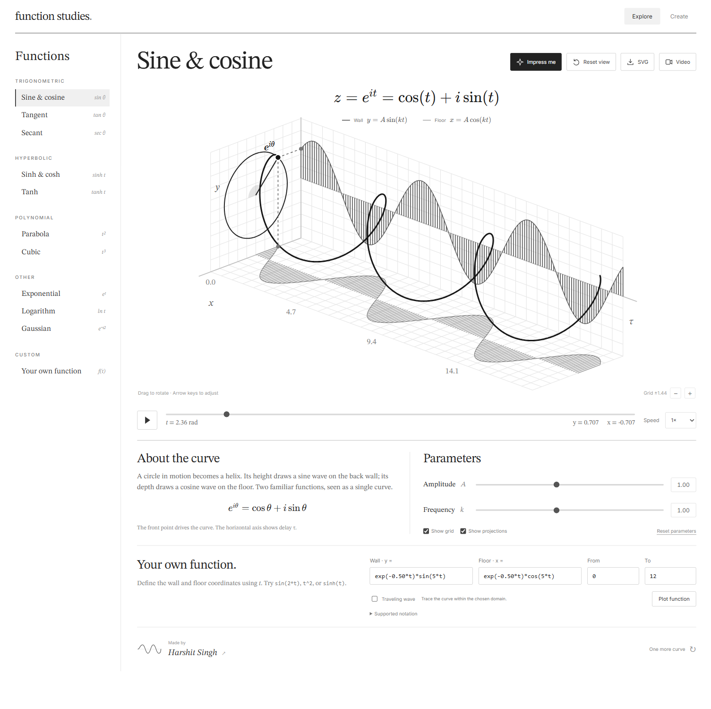

# Function Studies

[](#product-status) [](package.json) [](https://github.com/HarshitKumar9030/function-studies/actions/workflows/checks.yml) [](https://react.dev) [](https://www.typescriptlang.org) [](https://pnpm.io) [](#deploy-on-vercel)

See how functions move. A rotating point, a 3D curve and its two projections share the same animation, so you can follow the relationship between them.



## What you can do

- Explore sine and cosine, tangent, secant, hyperbolic functions, parabolas, cubics, exponentials, logarithms and Gaussian curves.
- Rotate the view, scrub through time, adjust amplitude and frequency, and show or hide the grid and projections.
- Write your own expressions for both axes, choose a domain and decide whether to trace a curve or animate a traveling wave.
- Use **Impress me** to try 22 random curve families, from rose petals and a heart to cycloids, catenaries and chirping spirals.
- Describe a function in the **Create** chat, then plot and edit the result.
- Read Markdown responses with lists, tables and properly rendered mathematical notation.
- Save the graph as SVG or record a video with a preview before downloading.
- Use the same controls on mobile, with a hamburger menu for the function library.
- Play at 0.25×, 0.5×, 1× or 2×. Space plays or pauses, R resets the view, and the bracket keys change speed.

## Product status

**Released · v1.0.0**

| Feature                                 | Status                                                                     |
| --------------------------------------- | -------------------------------------------------------------------------- |
| Presets, playback and 3D rotation       | Available                                                                  |
| Custom expressions and random functions | Available                                                                  |
| Chat function creation                  | Public allowance or your own API key                                       |
| Public AI token budget                  | 500,000 tokens per day, shared across visitors                             |
| SVG and video export                    | Available; video format depends on the browser                             |
| Mobile layout                           | Available                                                                  |
| Vercel deployment                       | Live at [function-studies.vercel.app](https://function-studies.vercel.app) |
| Saved chat history                      | Not yet; conversations last for the current page session                   |

## Run locally

Use Node.js 22 and pnpm 10.

```sh
pnpm install
pnpm dev
```

Open **http://127.0.0.1:5178**.

```sh
pnpm test     # Mathematical identities, expression parsing and generated functions
pnpm build    # Type checking and production build
pnpm start    # Serve the production build with the API
pnpm format   # Format source, styles, configuration and documentation
```

### Enable the function assistant

Copy `.env.example` to `.env.local` and set your Google AI API key:

```dotenv
GEMINI_API_KEY=your_api_key
MONGODB_URI=your_mongodb_connection
```

Restart the server after changing the environment. The key stays on the server. Presets, the manual editor, random functions and exports work without it. The assistant sends your submitted conversation to the provider; responses are validated before they can be plotted.

## Deploy on Vercel

1. Import this GitHub repository into Vercel.
2. Use the repository root and the **Vite** framework preset.
3. Add `GEMINI_API_KEY` and `MONGODB_URI` under project environment variables for the public assistant. Do not prefix either with `VITE_`.
4. Deploy. The included configuration uses `pnpm install --frozen-lockfile`, `pnpm build` and the `dist` output directory. The `api` folder provides the server endpoints.

The graph runs in the browser. Only chat needs the server API. MongoDB stores the shared public token allowance in the separate `function_studies.daily_ai_usage` collection; it does not store chat history or personal keys. BYOK works without the shared database.

The build also bundles the API and its local TypeScript dependencies into `server-build/api.js`. Vercel's JavaScript endpoints load that compiled file, and `vercel.json` explicitly includes it in both function packages. Run `pnpm test:deployment` after `pnpm build` to check the packaged entry points without a TypeScript loader.

## Public allowance and your own key

The public assistant has a shared **500,000-token daily cap**, resetting at midnight in India (Asia/Kolkata). This covers input, output and thinking tokens for all three assistant stages, including scope reviews.

Before each provider call, an atomic MongoDB update reserves a conservative input allowance and the full output allowance. Concurrent requests cannot reserve beyond the daily cap. The reservation is reconciled with the provider's reported total usage; failed or interrupted calls with unknown usage retain their reservation. The app can therefore stop before the exact token count reaches the cap. If the database is unavailable, public generation stops rather than bypassing the limit.

Open **AI access** in the bottom corner of Create to see the allowance or use your own Google AI key. The key stays in tab memory and is sent only with your requests to the app server and provider. It is not saved, logged or included in analytics. Refreshing clears it. BYOK uses the same math harness and never falls back to the public key.

## Analytics

Vercel Web Analytics is integrated through the React component. Enable Web Analytics in the Vercel project's Analytics tab. The app does not send chat text or API keys as custom analytics events.

## Contributing

See [CONTRIBUTING.md](CONTRIBUTING.md) for setup and checks. Issue forms are available for bugs, feature requests and mathematical accuracy reports.

## Assistant scope

The assistant handles greetings, simple conversation, arithmetic, math explanations and function plots. Asking “what is 2+2?” or “what does sine do?” gets an answer without creating an unwanted graph. Requests pass through a separate scope review before generation. The generator receives a scoped rewrite rather than the raw chat, and its output is reviewed again before it reaches the browser. Substantive unrelated tasks and attempts to override instructions are refused.

Browser-supplied assistant messages are treated as untrusted context. Graph context retains only validated coordinates, and instruction overrides are removed from earlier conversation. Generated expressions must pass the bounded arithmetic parser, domain checks and drawable-curve checks. The assistant has no tools, filesystem access or ability to execute code.

Markdown supports emphasis, lists, tables, code formatting and LaTeX math. Raw HTML, embedded images and clickable links are disabled in chat. KaTeX runs with trust disabled and bounded expansion.

These layers reduce prompt injection risk; they are not a guarantee that a model can never be misled. Automated tests cover scope refusals, role spoofing, input isolation and output validation.

## Expressions and exports

Custom expressions accept `t` (or `x`), `pi`, `e`, arithmetic, powers and functions such as `sin`, `cos`, `sinh`, `cosh`, `tanh`, `exp`, `log`, `sqrt` and `abs`. For example, try `sin(3*t)` with `cos(2*t)`. Expressions use a bounded parser rather than JavaScript evaluation.

Undefined points and discontinuities are separated. Tangent and secant presets are cropped at ±3 times the amplitude to keep their poles readable.

Video exports render locally at 1280 × 800, targeting 30 fps. Choose 6, 12 or 18 seconds. MP4 is used when supported, otherwise WebM. Keep the tab visible while recording; frame rate depends on the device. SVG exports keep the graph as editable vector artwork.

## Built with

React, TypeScript, Vite, Express, SVG and the browser MediaRecorder API. STIX Two Text and KaTeX provide the mathematical typography; Inter is used for controls. Fonts are bundled locally.

Made by [Harshit Singh](https://harshit.page).
